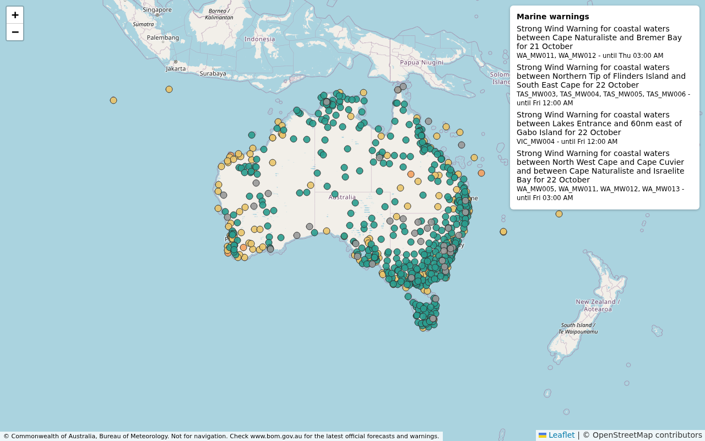

# BOM FTP Parser

Reads the Australian Bureau of Meteorology's anonymous FTP feeds and returns plain Python dicts:

- **Station readings**: the latest wind, gust, direction, temperature and pressure at every BOM station
  (about 800), all seven states.
- **Coastal waters forecasts**: BOM's own forecast text per coastal and local waters zone and period, and
  each state's synopsis.
- **Marine warnings**: current strong wind, gale, storm force and hurricane force warnings (and other CAP
  warnings that name a coastal waters zone), with cancellations and expired warnings removed.

It is one file, `bom_ftp.py`, using only the Python standard library (3.10+). It needs no account, key or
config. Copy the file into your app. Add `bom_db.py` if you also want the data in a database.

## Use

```python
import bom_ftp

feed = bom_ftp.Feed()          # keep this between passes
data = bom_ftp.fetch_all(feed)  # one FTP session, every product

for s in data["stations"]:
    print(s["name"], s["wind_kn"], s["dir"])
```

Run `fetch_all` every five minutes or so with the same `Feed`. The feed asks the server for each file's
modification time (`MDTM`) and downloads a file again only when that time has changed. Withdrawn
warnings drop out of the cache.

From the command line: `python bom_ftp.py > bom.json`.

If you already have the files, from your own fetcher or saved fixtures, skip FTP:

```python
data = bom_ftp.parse_all({"IDN60920.xml": raw_bytes, ...})
stations = bom_ftp.parse_observations(raw, "N")       # state letter: N V Q S T W D
zones, synopsis = bom_ftp.parse_forecast(raw)
warnings = bom_ftp.parse_warning(raw, now=time.time())
```

A file that fails to parse is logged (logger `bom_ftp`) and skipped; the rest of the pass still comes
through. `Feed.fetch` raises on connection errors, so wrap it in your own retry or loop.

## Output

`fetch_all` / `parse_all` return:

```jsonc
{
  "fetched": 1792577712.3,               // epoch seconds
  "attribution": "© Commonwealth of Australia, Bureau of Meteorology",
  "links": {"coastal": "...", "warnings": "..."},
  "disclaimer": "Not for navigation. ...",
  "stations": [{
    "id": "066214", "name": "Sydney - Observatory Hill", "state": "NSW",
    "lat": -33.8593, "lon": 151.2048, "height_m": 43.37,
    "t": 1792577400.0,                    // reading time, epoch seconds UTC
    "wind_kn": 9.0, "gust_kn": null, "dir": 67.0,   // dir = degrees the wind comes from
    "temp_c": 19.4, "pressure_hpa": 1024.7,
    "url": "https://www.bom.gov.au/products/IDN60901/IDN60901.94768.shtml"
  }],
  "zones": {"NSW_MW004": {
    "name": "Sydney Coast: Broken Bay to Port Hacking", "product": "IDN11001",
    "issued": 1792559100.0, "parent": "NSW_FA001",
    "periods": [{"start": 1792558800.0, "end": 1792587600.0,
                 "text": {"forecast_winds": "...", "forecast_seas": "...", "forecast_swell1": "...",
                          "forecast_weather": "..."}}]
  }},
  "synopsis": {"NSW_FA001": "A high in the Tasman Sea ..."},   // by state region, or by zone for local waters
  "warnings": [{
    "id": "AusBoM-IDT20100-...", "headline": "Strong Wind Warning for ...",
    "event": "Wind", "level": "strong",   // hurricane | storm | gale | strong | other
    "severity": "Moderate", "effective": 1792587600.0, "expires": 1792674000.0,
    "zones": ["TAS_MW003", "TAS_MW004"], "url": "https://www.bom.gov.au/weather-and-climate/..."
  }]
}
```

Any value that is missing, out of range or in unexpected units (for example a gust in km/h where knots
were expected) is `null`, not converted or guessed.

Zones are BOM AMOC area codes (`NSW_MW004` is the Sydney Coast). **[docs/zones.md](docs/zones.md) lists
every zone** by state, about 80 in all, from Gabo Island to the Gulf of Carpentaria. When a zone appears in
both a state bundle and a local waters product, the later issue wins.

## Products read

All files are in `ftp://ftp.bom.gov.au/anon/gen/fwo/`.

| File | What |
|---|---|
| `IDN60920.xml`, `IDV`, `IDQ`, `IDS`, `IDT`, `IDW`, `IDD` | Latest station readings, one per state |
| `IDN11001`, `IDV10200`, `IDQ11290`, `IDS11072`, `IDT12329`, `IDW11160`, `IDD11030` | State coastal waters forecasts |
| `IDN11013`, `IDV10465`, `IDT12460`, `IDS10035`, `IDW11500` | Local waters: Sydney Enclosed Waters, Port Phillip and Western Port, the Derwent, Adelaide, Perth |
| `ID?#####.cap.xml` | CAP warnings; only those naming a coastal waters zone are kept |

To add a product, append it to `FORECASTS` (coastal waters format) or `OBSERVATIONS` (the 60920 format).

## Storing it in a database (optional)

`bom_db.py` stores each pass in SQLite (standard library `sqlite3`) and keeps history: every station
reading, every forecast issue and every warning seen.

```python
import bom_ftp, bom_db

conn = bom_db.connect("bom.sqlite")         # creates the tables if they are missing
feed = bom_ftp.Feed()
bom_db.save(conn, bom_ftp.fetch_all(feed))  # repeat every five minutes; re-saving a pass doubles nothing
bom_db.prune(conn, days=30)                 # now and then, to bound the size
```

Or from the command line: `python bom_db.py bom.sqlite --loop`.

Without network access, load the sample instead: `python bom_db.py bom.sqlite --load samples/bom.json`.
[`samples/bom.json`](samples/bom.json) is a real `bom_ftp.py` output cut down to six stations, six zones
and three warnings (21 October 2026), so you can see the shape and try the queries.

### Tables

| Table | Key | Holds |
|---|---|---|
| `stations` | `id` | Name, state, position, height, BOM page link; `last_seen` |
| `observations` | `station_id, t` | Every reading: wind, gust, direction, temperature, pressure |
| `zones` | `aac` | Each coastal waters zone and the time of its latest forecast issue |
| `forecast_periods` | `aac, issued, start_t` | Every forecast issue's periods; `texts` is JSON (`forecast_winds`, `forecast_seas`, ...) |
| `synopses` | `aac` | The latest synopsis per state region (`zones.parent`), or per zone for local waters |
| `warnings` | `id, headline` | Every warning seen, with `first_seen`, `last_seen` and `withdrawn` |
| `warning_zones` | `id, headline, aac` | Which zones each warning covers |

Times are epoch seconds (UTC). A warning that leaves the feed before it expires was withdrawn or cancelled
by BOM. It gets `withdrawn` set and stops counting as active.

### Queries

Ready-made functions, all returning lists of dicts:

```python
bom_db.latest(conn, state="NSW")               # each station's latest reading, windiest first
bom_db.find_stations(conn, "sydney")           # by name
bom_db.nearest(conn, -33.85, 151.27, km=10)    # by distance, with "km"
bom_db.history(conn, "066214", since=t0)       # one station's readings over time
bom_db.search_zones(conn, "sydney")            # NSW_MW004 Sydney Coast, NSW_MW009 Sydney Enclosed Waters
bom_db.forecast(conn, "NSW_MW004")             # latest issue, periods not yet ended, plus the synopsis
bom_db.active_warnings(conn, aac="NSW_MW004")  # or state="TAS", or neither for all of Australia
bom_db.warnings_between(conn, since, until)    # history, withdrawn ones included
```

[`queries.sql`](queries.sql) has the same queries as raw SQL, plus a few more: the strongest gust per
station, hourly averages, how a forecast changed issue by issue, and gale days per zone. Try them in
`sqlite3 bom.sqlite`.

### PostgreSQL or another database

The schema (`bom_db.SCHEMA`) and the queries are plain SQL that run on PostgreSQL. Two queries need a
change, and each is noted in `queries.sql`: JSON access (`->>` instead of `json_extract`) and hour
buckets (`FLOOR`). All of `queries.sql` has been checked against PostgreSQL 17. To use psycopg, run
`SCHEMA` once, then copy `save()` and change the `?` placeholders to `%s`. Upserts use `ON CONFLICT`,
which both databases support. In PostgreSQL you may want `texts` as `jsonb`.

## Examples

[`examples/`](examples/README.md) has four small apps: a terminal check of one place (no database), a
web app with a JSON API and a live wind map, the same API in FastAPI, and alerts for warnings or strong
wind with an optional webhook.



## Zone outlines (optional)

To draw the zones or warnings on a map, build GeoJSON from BOM's spatial dataset IDM00003
(`ftp://ftp.bom.gov.au/anon/home/adfd/spatial/`):

```sh
uv run --with pyshp --with shapely python tools/build_zones.py IDM00003.shp bom_zones.geojson
```

It keeps the coastal waters (`_MW`) zones and simplifies them to about 500 m. Each feature carries the
properties `aac`, `name` and `state`, so you can join it to `zones` and `warnings[].zones`. The built file is
not committed here; build it when you need it and again when BOM changes the zones (rarely).

## Safety

- XML with a DTD or entity declaration is rejected before parsing (no entity expansion or external fetch).
- Each file is capped at 3 MB; bigger files are skipped.
- Numbers are range-checked and must be finite; times must carry a timezone.
- Only anonymous FTP is used, and there are no credentials, keys or hosts other than `ftp.bom.gov.au`.

## Terms

The data is © Commonwealth of Australia, Bureau of Meteorology. BOM offers the anonymous FTP feeds for
personal and non-commercial use; showing them on a public or commercial site may need BOM's agreement
(see BOM's copyright and Registered User pages). Show the `attribution` and `disclaimer` wherever you
display the data. This is not for navigation: BOM's website is the official source.

## Tests

Offline, no network: `python test_bom_ftp.py && python test_bom_db.py` (or `pytest`). The database
tests also run every query in `queries.sql` against the sample.

## Licence

The code is under the [MIT licence](LICENSE). The licence covers the code only: the BOM data it fetches,
including `samples/bom.json`, stays under BOM's terms (see Terms above).
